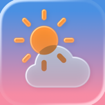

<p align="center">

</p>
<h1 align="center">Eesti Ilm – Estonian weather forecast</h1>
<p align="center">
<a href="https://github.com/Shiaulis/Eesti-Ilm/actions/workflows/ci.yml"></a>

<a href="https://developer.apple.com/swift/"></a>
<a href="https://github.com/Shiaulis/Eesti-Ilm/commits/master"></a>
<a href="https://github.com/Shiaulis/Eesti-Ilm/graphs/contributors"></a>
</p>

> [!NOTE]
> **Status:** Eesti Ilm is being revived. Version 2.3 is in development, and the app is temporarily not available on the App Store. You can try the 2.3 beta on [TestFlight](https://testflight.apple.com/join/xlLG9DS9).

## About

Eesti Ilm is a simple iOS weather app for Estonia. It shows the forecast published by the Estonian Environment Agency's weather service, [ilmateenistus.ee](https://www.ilmateenistus.ee).

Features:

- A forecast list for the coming days.
- A home-screen widget (small and medium sizes).

The app is localized in English and Estonian.

## Requirements

- macOS with Xcode 27.2 or later. The project file uses Xcode's JSON project format (`EstonianWeather.xcodeproj/project.xcproj`), which Xcode 26 and earlier cannot open
- iOS 27.0 or later (device or simulator)
- Swift 6 (ships with Xcode)
- [SwiftFormat](https://github.com/nicklockwood/SwiftFormat), for formatting: `brew install swiftformat`
- Ruby and Bundler, only for releasing (see [Releasing](#releasing))

## Getting started

```sh
git clone https://github.com/Shiaulis/Eesti-Ilm.git
cd Eesti-Ilm
open EstonianWeather.xcodeproj
```

Xcode resolves the third-party Swift Package dependencies on first open. Select the `EstonianWeather` scheme, pick an iOS simulator and press Run (⌘R).

To run on a physical device, select your own development team under *Signing & Capabilities* for the targets. Signing is automatic.

## Tests and formatting

CI runs the format check and the test plan. The build command is a quicker local check.

Format check:

```sh
swiftformat --lint .
```

To fix formatting locally, run `swiftformat .`. The style is defined in [`.swiftformat`](.swiftformat).

Build:

```sh
xcodebuild build -project EstonianWeather.xcodeproj -scheme EstonianWeather -destination 'generic/platform=iOS Simulator' CODE_SIGNING_ALLOWED=NO
```

Test (use any installed iPhone simulator; CI picks the newest one available):

```sh
xcodebuild test -project EstonianWeather.xcodeproj -scheme EstonianWeather -testPlan EstonianWeather -destination 'platform=iOS Simulator,name=iPhone 18 Pro,OS=latest' CODE_SIGNING_ALLOWED=NO
```

The `EstonianWeather` test plan runs `EstonianWeatherTests`, `NetworkingTests`, and `WeatherCoreTests`. `WeatherCoreTests` calls the live ilmateenistus.ee feed, so it needs network access.

Tests use [Swift Testing](https://developer.apple.com/documentation/testing).

CI runs on GitHub Actions ([`.github/workflows/ci.yml`](.github/workflows/ci.yml)) for every pull request and every push to `master`.

## Project structure

| Path | Contents |
| --- | --- |
| `EstonianWeather/` | The app target: UIKit view controllers for the forecast list and Settings |
| `EstonianWeatherWidget/` | The home-screen widget extension (`EstonianWeatherWidgetExtension`, SwiftUI) |
| `EstonianWeatherTests/` | App unit tests (Swift Testing) |
| `WeatherCore/` | Dynamic framework target: fetches the forecast and parses the XML feed |
| `WeatherCoreTests/` | Unit tests for `WeatherCore` (Swift Testing) |
| `Networking/` | Dynamic framework target: HTTP layer used by `WeatherCore` |
| `NetworkingTests/` | Unit tests for `Networking` (Swift Testing) |
| `Resources/` | Shared resources: `Localizable.xcstrings`, the `EstonianWeather` test plan, `Settings.bundle` |
| `ReleaseRelatedInfo/` | README images and app icon sources |
| `fastlane/` | Release tooling, App Store metadata (`fastlane/metadata/`) and screenshots (`fastlane/screenshots/`) |
| `.github/workflows/ci.yml` | CI workflow |
| `.swiftformat` | SwiftFormat configuration |

## Dependencies

`WeatherCore` and `Networking` are dynamic framework targets inside `EstonianWeather.xcodeproj` (`WeatherCore` depends on `Networking`). Both used to be separate repos (weatherCore and networking) and were merged into this repository with their git history. They are not versioned or tagged separately: a change to them goes in the same pull request as the app change that needs it.

Third-party dependencies, managed through Swift Package Manager in `EstonianWeather.xcodeproj`: [SWXMLHash](https://github.com/drmohundro/SWXMLHash) (`WeatherCore`) and [swift-http-types](https://github.com/apple/swift-http-types) (`Networking`).

## Releasing

Release tooling is [fastlane](https://fastlane.tools), run through Bundler. The Ruby version is pinned in [`.ruby-version`](.ruby-version).

```sh
bundle install
bundle exec fastlane metadata
bundle exec fastlane screenshots
```

`fastlane metadata` uploads the App Store metadata in [`fastlane/metadata/`](fastlane/metadata/) (`en-US` only, because App Store Connect has no Estonian listing; the app itself is localized in English and Estonian). It authenticates with an App Store Connect API key read from these environment variables:

- `APP_STORE_CONNECT_API_KEY_KEY_ID`
- `APP_STORE_CONNECT_API_KEY_ISSUER_ID`
- `APP_STORE_CONNECT_API_KEY_KEY`

`fastlane screenshots` uploads the App Store screenshots in [`fastlane/screenshots/en-US/`](fastlane/screenshots/en-US/) (iPhone 6.9" at 1320x2868 and iPad 13" at 2064x2752, three each; file names sort in display order) and replaces the screenshots already on the App Store version. It uses the same API key.

Never commit the key or its values.

Versions are tagged as plain `X.Y.Z` (no `v` prefix). Earlier releases: 1.2.0, 1.3.1, 1.4.0, 2.0.0, 2.1.0, 2.1.1 and 2.2.0. Version 2.3 is in progress.

## Contributing

Ideas and bug reports are welcome as [issues](https://github.com/Shiaulis/Eesti-Ilm/issues), and pull requests are welcome too. Before opening a pull request, run the format check, build and tests above. Project conventions are in [AGENTS.md](AGENTS.md).

To report a security issue, see [SECURITY.md](SECURITY.md). How the app handles data is described in the [Privacy Policy](Privacy%20Policy.md).

## License

Copyright © 2020–2026 Andrius Shiaulis.

Licensed under the MIT License. See [LICENSE](LICENSE).
