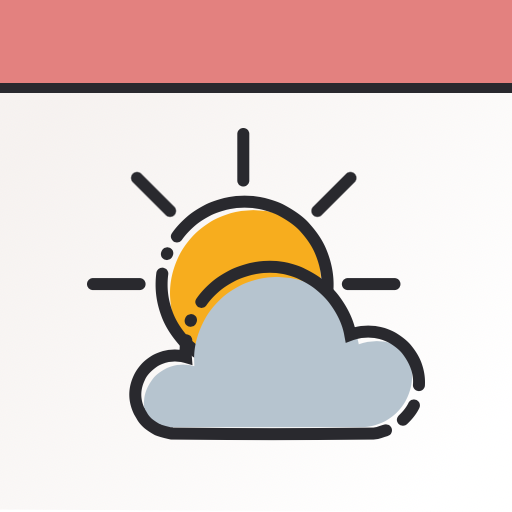

<p align="center">

</p>
<h1 align="center">Eesti Ilm – Estonian weather forecast</h1>
<p align="center">
<a href="https://github.com/Shiaulis/Eesti-Ilm/actions/workflows/ci.yml"></a>

<a href="https://developer.apple.com/swift/"></a>
<a href="https://github.com/Shiaulis/Eesti-Ilm/commits/master"></a>
<a href="https://github.com/Shiaulis/Eesti-Ilm/graphs/contributors"></a>
</p>

> [!NOTE]
> **Status:** Eesti Ilm is being revived. Version 3.0 is in development, and the app is temporarily not available on the App Store.

## About

Eesti Ilm is a simple iOS weather app for Estonia. It shows the forecast published by the Estonian Environment Agency's weather service, [ilmateenistus.ee](https://www.ilmateenistus.ee).

Features:

- A forecast list for the coming days.
- A home-screen widget (small and medium sizes).

The 3.0 interface is being rebuilt, so on `master` both screens are still placeholders.

The app is localized in English and Estonian.

## Requirements

- macOS with Xcode 27.2 or later
- iOS 27.0 or later (device or simulator)
- Swift 6 (ships with Xcode)
- [SwiftFormat](https://github.com/nicklockwood/SwiftFormat), for formatting: `brew install swiftformat`
- Ruby and Bundler, only for releasing (see [Releasing](#releasing))

## Getting started

```sh
git clone https://github.com/Shiaulis/Eesti-Ilm.git
cd Eesti-Ilm
open EstonianWeather.xcodeproj
```

Xcode resolves the Swift packages on first open. Select the `EstonianWeather` scheme, pick an iOS simulator and press Run (⌘R).

To run on a physical device, select your own development team under *Signing & Capabilities* for both targets. Signing is automatic.

## Tests and formatting

These are the same commands CI runs.

Format check:

```sh
swiftformat --lint .
```

To fix formatting locally, run `swiftformat .`. The style is defined in [`.swiftformat`](.swiftformat).

Build:

```sh
xcodebuild build -project EstonianWeather.xcodeproj -scheme EstonianWeather -destination 'generic/platform=iOS Simulator' CODE_SIGNING_ALLOWED=NO
```

Test (needs an iPhone 18 Pro simulator):

```sh
xcodebuild test -project EstonianWeather.xcodeproj -scheme EstonianWeather -testPlan EstonianWeather -destination 'platform=iOS Simulator,name=iPhone 18 Pro,OS=latest' CODE_SIGNING_ALLOWED=NO
```

Tests use [Swift Testing](https://developer.apple.com/documentation/testing) and live in the `EstonianWeatherTests` target.

CI runs on GitHub Actions ([`.github/workflows/ci.yml`](.github/workflows/ci.yml)) for every pull request and every push to `master`.

## Project structure

| Path | Contents |
| --- | --- |
| `EstonianWeather/` | The app target: SwiftUI views for the forecast list and the About screen |
| `EstonianWeatherWidget/` | The home-screen widget extension (`EstonianWeatherWidgetExtension`) |
| `EstonianWeatherTests/` | Unit tests (Swift Testing) |
| `Resources/` | Shared resources: `Localizable.xcstrings`, the `EstonianWeather` test plan, `Settings.bundle` |
| `ReleaseRelatedInfo/` | README images, app icon sources and App Store screenshots |
| `fastlane/` | Release tooling and App Store metadata (`fastlane/metadata/`) |
| `.github/workflows/ci.yml` | CI workflow |
| `.swiftformat` | SwiftFormat configuration |

## Dependencies

Dependencies are managed with Swift Package Manager inside the Xcode project.

- [weatherCore](https://github.com/Shiaulis/weatherCore): fetches the forecast and parses the XML feed.
  - [networking](https://github.com/Shiaulis/networking): HTTP layer used by weatherCore.
- Third-party, pulled in by the packages above: [SWXMLHash](https://github.com/drmohundro/SWXMLHash) and [swift-http-types](https://github.com/apple/swift-http-types).

weatherCore and networking are maintained by the same author. A change there is merged, tagged as `X.Y.Z`, and then the version is bumped here.

## Releasing

> [!IMPORTANT]
> The Apple Developer membership is currently lapsed. Until it is renewed, nothing can be signed for distribution or uploaded to App Store Connect. Builds through Xcode Cloud and TestFlight are planned after the renewal.

Release tooling is [fastlane](https://fastlane.tools), run through Bundler. The Ruby version is pinned in [`.ruby-version`](.ruby-version).

```sh
bundle install
bundle exec fastlane metadata
```

`fastlane metadata` uploads the App Store metadata in [`fastlane/metadata/`](fastlane/metadata/) (`en-US` only, because App Store Connect has no Estonian listing; the app itself is localized in English and Estonian). It authenticates with an App Store Connect API key read from these environment variables:

- `APP_STORE_CONNECT_API_KEY_KEY_ID`
- `APP_STORE_CONNECT_API_KEY_ISSUER_ID`
- `APP_STORE_CONNECT_API_KEY_KEY`

Never commit the key or its values.

Versions are tagged as plain `X.Y.Z` (no `v` prefix). Earlier releases: 1.2.0, 1.3.1, 1.4.0, 2.0.0 and 2.1.0. Version 3.0 is in progress.

## Contributing

Ideas and bug reports are welcome as [issues](https://github.com/Shiaulis/Eesti-Ilm/issues), and pull requests are welcome too. Before opening a pull request, run the format check, build and tests above. Project conventions are in [AGENTS.md](AGENTS.md).

To report a security issue, see [SECURITY.md](SECURITY.md). How the app handles data is described in the [Privacy Policy](Privacy%20Policy.md).

## License

Copyright © 2020–2026 Andrius Shiaulis.

Licensed under the MIT License. See [LICENSE](LICENSE).
